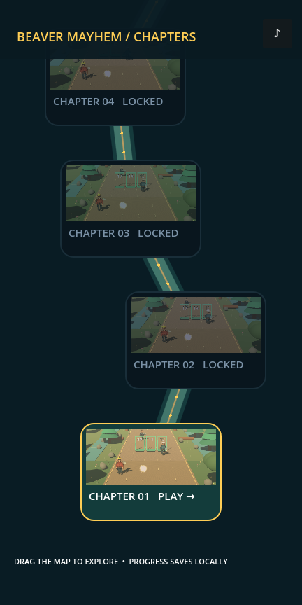
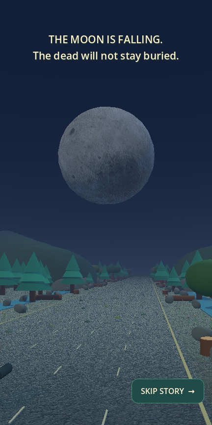
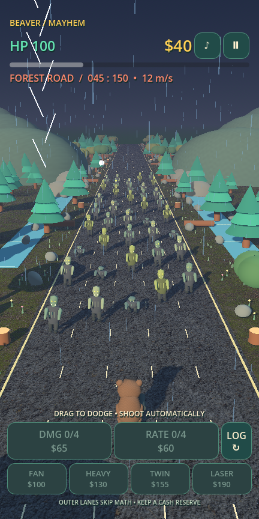
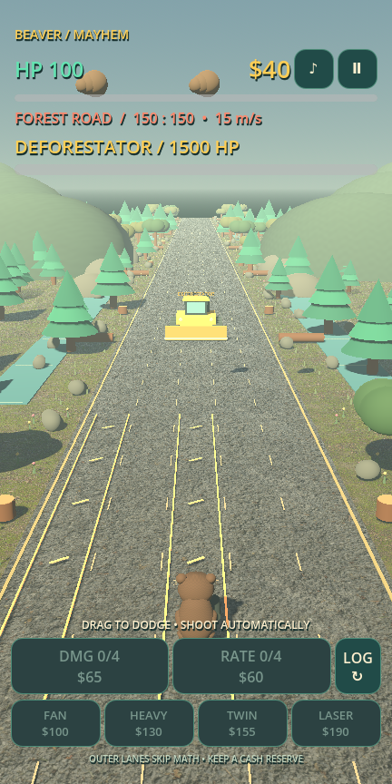

# BEAVER MAYHEM
### REVENGE OF THE FOREST

An offline **3D runner shooter for Android**, built in Godot 4.7.2 with GDScript.
One beaver, five lanes, flying logs, angry lumberjacks, weapon seizures, arithmetic
and a very large bulldozer. MIT licensed. Asset sources and free licenses are recorded in [ASSETS.md](docs/ASSETS.md).

[Download the debug APK](https://github.com/CanisLegatus/beaver-mayhem/releases/tag/v0.3.0)

 

 

- Fixed opaque character meshes and stable PBR pavement with smooth lighting.
- Warned TESLA/Cybertruck traffic, night comet impacts and shard hazards.
- Moonfall chapter: falling-Moon story, storm, zombie hordes and Titan QTE dodges.
- Attacking dozer: missile fans, rams and dirt throws; a larger HP pool in a smaller body.
- Kevin MacLeod action tracks, recorded voices/ambience and offline credits.
- A saved vertical roadmap of ten chapters; each unlocks after the previous victory.
- A skippable family-at-the-dam story and 360° hero camera orbit before chapter one.
- Day/night lighting and varied forest, river and rock scenery.
- A complete 150-second accelerating run followed by a destructible bulldozer boss.
- Three attacking enemy types, straight shots and staged, dodgeable guided rockets.
- Physical cash pickups, breach penalties, negative balance and ten-second seizures.
- Five weapons, capped upgrades and a shop that stays live while you run.
- Procedural math gates: three answers and two neutral bypass lanes.
- Main menu, pause, victory, defeat, full restart and mute.

## Play
Choose an unlocked chapter on the roadmap (scroll vertically to explore). The first
chapter opens with a twelve-second story; Skip Story begins gameplay immediately.
After victory, continue to the next chapter or return to the map.

Android: drag horizontally to dodge and line up shots. Shooting is automatic.
Collect coins locally. Choose a math answer by crossing its gate; outer lanes skip.
Buy upgrades/weapon tiles at the bottom; tap an owned weapon to equip it, or use ↻
to cycle. Keep cash in reserve: ten seconds in debt costs a purchased asset.

Desktop: mouse drag, A/D or arrow keys. Escape pauses. No jump or dash.

## Develop and build
Open `project.godot` in **Godot 4.7.2 standard** and press F6/F5, or run:

```sh
~/.local/bin/godot --path .
./tools/check.sh
ANDROID_HOME="$HOME/.local/share/beaver-android-sdk" ./tools/build_android.sh
```

Android export needs JDK 17, official Android SDK with Build Tools 36.0.0/Platform
36 and matching Godot templates. Output: `builds/beaver-mayhem-debug.apk`.
QTEs: tap/swipe LEFT, DUCK or RIGHT; desktop A/Q, S/Space, D/E.
The map i button opens complete offline music/asset credits.

See [build/install details](docs/BUILD.md) for setup and ADB commands.

## Status
Version 0.3.0 is a playable Android debug release, with headless rules/integration
checks, deterministic full-scene simulations and graphical Linux checks. Real-device
Android touch, installation and Poco X7 Pro 60 FPS performance are **not verified**.
The first two chapters have distinct combat, stories and bosses; later chapters share forest combat with different weather. Progress saves
locally; money and upgrades reset per run. This is not an endless runner or a live-service game. There are no ads, accounts or online requirements.

[Design](docs/GDD.md) · [Architecture](docs/ARCHITECTURE.md) ·
[Balance](docs/BALANCE.md) · [Testing](docs/TESTING.md) ·
[Decisions](docs/DECISIONS.md) · [Итоговый отчёт](docs/DELIVERY.md) · [Plan](PLAN.md) · [MIT license](LICENSE)

Godot Engine is MIT licensed; see the [Godot license and third-party notices](https://godotengine.org/license/).
